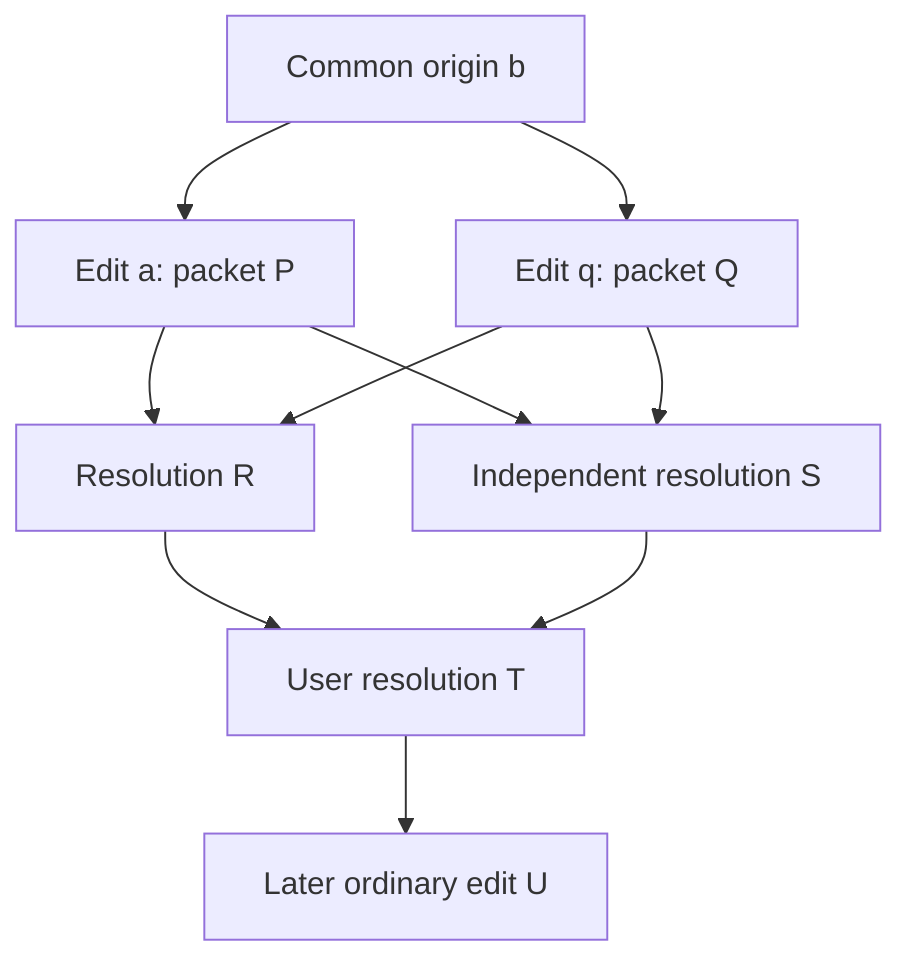

# User-chosen conflict resolution through immutable packets

Date: 2026-10-12. Status: design proposal; no implementation changes.

## Recommendation and boundaries

Adopt option A, but **do not implement it as merely `parent in parents`**. Use an explicit, versioned resolution transaction containing complete final rows/tombstones for a closed set of affected keys, authenticated references to the original packets and ancestry, and an atomic supersession ledger. Accept a resolution from any *proved covered ancestor*, not just an immediate parent. Preserve packet atomicity, user choice, tombstones, and immutable history.

A full-state packet without ancestry/coverage proofs is unsafe; a bare `supersedes: [uuid]` marker is also unsafe. Both can lose companion changes. A peer at the common baseline cannot pass an immediate-parent membership check. Concurrent resolutions require a subsequent human resolution; there is no unconditional convergence under perpetual concurrent edits or choices.

Initial implementation should resolve same-lineage divergent edits (including delete/update), and refuse baseline mismatch, invalid/reused identities, and relational repairs it cannot fully enumerate. Natural-key and FK repairs can use the same protocol with an explicit multi-row plan, but should be a separate implementation gate, not implicit behavior of “keep mine.”

Requirements: no automatic last-writer-wins, no silent loss of companion rows, atomic application and durable replay decisions, local-only display of private content, exact identity binding, bounded packet parsing, recoverable publication, and offline replay. The cost is more retained provenance and potentially large conflict components. No new service or database engine is needed.

## Evidence scope

All unqualified `file:line` references are relative to this repository at HEAD `5c7eff7` (merge of PR #31). PR #27 is in local history. `memory-sync/install_join.py` is **absent from this checkout**. Its implementation was inspected read-only using `git show ac6b814:memory-sync/install_join.py`; citations prefixed `ac6b814:` refer to that local commit, not HEAD. The requested PR #30 integration must be rechecked against the eventual merged join code. No network, checkout, index changes, or other git writes were performed.

Current shadow holds the current row/revision, including tombstones; history holds revision identity only, **not parent edges or historical rows** (`memory-sync/memory_sync.py:64`, `:65`, `:348`). Capture writes a new revision, advances shadow/history, and inserts its immutable packet in one transaction (`:124`, `:135`, `:145`). Locally authored packets have outbox identity rather than receive receipts (`:261`). Publish retries exact immutable content (`:170`). Receive captures local edits before import and again under the packet transaction (`:363`, `:390`, `:410`). These protections must survive the redesign.

## 1. Today's exact failure taxonomy

The diagnostic is a packet-level, path-keyed category, not a durable structured conflict object. Multiple causes may exist in one packet; `_apply` reports causal issues before SQL constraints. A conflict takes priority over pending ancestry (`memory-sync/memory_sync.py:298–312`). Signed diagnostics intentionally retain only the exception class (`:417–422`), so listing must reconstruct evidence, not parse diagnostic messages.

| Cause | Actual classification and evidence | Resolution policy |
|---|---|---|
| Divergent ancestry | Incoming parent differs from shadow, and is known for the same table/key: conflict. Also conflict if incoming parent is null while a shadow exists (`memory_sync.py:304–307`). Null-parent insertion versus a tombstone is included. | Supported with verified common origin and full packet coverage. Explicit row or tombstone choice. |
| Unknown UUID parent | Parent differs and is neither known for that key nor baseline/null: pending (`:305–312`). A real fork can initially look pending until its ancestry is learned. | Fetch/verify evidence first; do not label every pending packet a fork. Then resolve only a proved divergence. |
| Baseline mismatch | Any mismatching `baseline:` parent is conflict, even without history (`:306–307`). Baseline hashes bind table, key, and row (`:77`). | Refuse ordinary resolution: different bootstrap states need separate baseline reconciliation. Never invent a common ancestor. |
| Natural-key/unique collision | SQL upsert targets only primary keys (`:327`); another unique index can throw `sqlite3.IntegrityError`, mapped to conflict (`:417–418`). | Conditional multi-row repair only. Different IDs remain different identities; a two-parent merge on one key cannot fix this. |
| FK rejection | After SQL, missing FK target with shadow evidence is conflict; missing target without shadow evidence is pending (`:337–347`). An immediate RESTRICT violation instead raises IntegrityError/conflict before this check. | Missing future dependencies remain pending. Known-deleted targets require an explicit closed repair (restore target or remove/retarget child). |
| Cascade/trigger rejection | Full actual rows must equal shadow plus exactly this packet. Off-packet cascade/trigger effects cause conflict (`:329–336`). | Conditional: enumerate affected children and their current heads, include explicit final states, otherwise refuse. Preserve this guard. |
| Reused revision | Any incoming revision already in history is conflict, regardless of key (`:308–309`), unless the whole packet already passes `_seen`. | Refuse identity repair. Do not legitimize a reused revision with a new parent list. Exact verified evidence reuse is distinct from applying a new packet that reuses an ID. |
| Invalid packet | Shape, format, group/node, UUID, checksum, table/key/range/type/columns, JSON, signature/trust failures generally become invalid (`:204–259`, `:395–407`, `:417–422`). Reused packet UUID with changed digest is invalid (`:261–265`). | Refuse. Resolution cannot waive validation, signature, revocation, or allocation rules. |
| Other SQL constraint failures | CHECK/NOT NULL and similar IntegrityError are also conflict, even if semantically an invalid row (`:418`). `_validate` does not enforce all SQL constraints. | Explicit corrected row only if provenance is sound and the complete final transaction satisfies schema; no blanket “resolve conflict” bypass. |

Unique constraints include source path, event key, `(source_path,line_hash)`, non-null memory key, and `(scope,scope_key,version)` (`memory-sync/schema.sql:4`, `:9`, `:25`, `:39`, `:50`). FK relationships include memory-item self references and memory-source links, with CASCADE for memory deletion and RESTRICT for event deletion (`:34`, `:41–44`). Primary keys are immutable (`memory-sync/memory_sync.py:88`). Deduplication therefore means explicit losing-row tombstones and link rewrites, never changing a primary key in place.

Failures roll back the packet transaction; diagnostics commit separately; no failed-packet receipt is written (`memory-sync/memory_sync.py:390–423`). Only pending paths retry within the same progressing pass (`:423–429`); conflicts are reconsidered on future receive calls, but no resolution operation exists (`memory-sync/SYNC.md:178`). Diagnostics can also outlive a disappeared exchange path; deletion of a file is not resolution.

## 2. Whole-packet closure and application

### Counterexample

Start with key x at revision b. Packet P has `x: b→a` and new companion y. Packet Q has `x: b→q` and new companion z. A locally captured P, B locally captured Q. A rejects all Q; B rejects all P. A resolution changing only x leaves A without z and B without y. Marking P/Q received hides that loss permanently. Replaying the originals after updating x fails their old x precondition again.

### ADR 1 — full-state closure, with supersession as bookkeeping

Decision: resolution R includes a fresh revision and final row/tombstone for **every key in every packet it absorbs**, on both sides, not just keys reported as conflicting. Uncontested y/z survive by default. For contested x the operator chooses. Keeping mine is a key-level choice; discarding another packet's unrelated changes requires explicit per-key decisions and a preview.

Build a fixed point:

1. Start from held packets and packets that produced competing local/remote heads. Snapshot uncaptured local edits into ordinary packets at commit time; a read-only preview simulates this without capturing.
2. Include all keys of those packets. Include intervening ancestor packets back to a verified common anchor; every absorbed packet brings all its keys. Include relevant local descendant packets known at planning time. Historical packets already applied on one peer still need coverage for peers that never applied them.
3. Expand for FK targets, affected children/cascades, and unique-key occupants needed for the final state. Read-only dependencies can be explicit preconditions; any dependency that must change joins the write set. Reject unsupported or excessive closure rather than silently truncating it.
4. For each key, record the verified branch frontier, its origin (baseline hash or key-specific absence), and a complete selected final row/tombstone. Fresh resolution revisions descend from all covered maximal branch revisions. A companion key may have only one frontier revision; it still receives an explicit resolution revision.
5. Bind the preview to source packet digests, local actual/shadow state, dependency preconditions, schema/protocol, and trust state. After typed confirmation, reacquire locks and `BEGIN IMMEDIATE`, recapture/recompute, and refuse stale plans before applying anything. Avoid holding a write lock while waiting for input.

Evidence consists of exact retained packets, referenced by UUID **and complete envelope digest** (and sender identity in signed mode), plus baseline witnesses where needed. References are preferred over embedding a recursively growing packet bundle. Locally persist verified packet evidence so disappearance of a transport file does not erase audit history. Missing referenced evidence makes R pending; it is never guessed. Publish dependencies before R when possible; transport ordering remains irrelevant. No garbage collection in this feature.

Validate evidence without requiring conflicting branches to have been applied. Evidence validation checks original wire rules, authorization, key/revision ownership, parent edges, and row binding. It does not turn branch rows into the receiver's application state or issue an applied receipt. An origin witness for a baseline must reproduce its existing hash; an absent origin is key-specific and cannot stand for an arbitrary missing baseline. A graph with cycles, cross-key parents, ambiguous revision definitions, or unproved roots is refused.

### Receiver transaction

For each key let r be R's proposed revision and h its current shadow revision. Use the verified per-key DAG, not equality of row contents:

- If h is a covered ancestor of r, install R's final row and advance to r. This includes the common baseline and, only for originally absent keys, absence.
- If h equals r, verify the same immutable definition and perform no row write.
- If h is a proved descendant of r, preserve h and its row. Never roll back a later edit to replay an older resolution. This path requires retained evidence of the descendant; row equality is insufficient.
- If h is incomparable with r, hold the **whole** resolution as conflict. If evidence is missing, hold pending. Include this newer branch in a subsequent user resolution.

Construct the complete prospective state with these decisions, check dependency preconditions, execute in FK-safe order, and retain whole-state/cascade and FK checks. Final constraint failure rolls everything back. Unique-value swaps may require deleting and reinserting the explicitly covered rows/links within the transaction; SQL execution planning must not generate unlisted cascade effects. Defer that capability if it cannot be proved safe.

In the same commit: record graph/evidence, advance shadows, record R's receipt (or its local outbox), record absorption dispositions, and clear only matching covered diagnostics. Receiver-side import must not produce echo captures. Never split one resolution's application into separately committed chunks.

“Exactly once” means one committed resolution effect per packet identity, no duplicate inserts or repeated old-state writes on replay, and no lost companion state. It does **not** mean executing every historical SQL statement: a losing version is intentionally replaced. Final state, ancestry, and disposition are the replicated contract; trigger side effects outside SQLite are not supported.

### ADR 2 — reject marker-only reapplication

A marker plus unchanged `_apply` cannot replay P/Q because x's parent still mismatches. Filtering conflicting changes out of P changes packet semantics and signed content; different receivers could filter differently. Blindly reapplying P after R overwrites the chosen state. Marking receipts first creates a crash window and suppresses companion changes forever.

A sophisticated marker algorithm could carry authenticated per-change decisions, closure, and an atomic replay plan. That is effectively the full-state design with greater execution-order dependence. Retain a `covers` list as an audit/duplicate suppression mechanism **only after** proving complete coverage and committing the final transaction.

## 3. Protocol, schema, and security

### ADR 3 — explicit version dispatch and a persisted revision DAG

Suggested unsigned format: `omp-memory-changes-v2`; signed: `agentmesh-signed-changes-v3`, with a new signing domain. Do not overload the existing scalar `parent` format. Both normal edits and resolutions after activation use the new protocol; normal edits have one parent. Proposed logical shape:

```text
format, group, node, uuid, kind: change|resolution,
body: [{table, key, row, revision, parents: [revision...], origin}],
covers: [{uuid, envelope_digest}], evidence: [{uuid, envelope_digest}],
checksum
```

Signed form additionally requires `encoding, sender, key_id, signature`. `covers` is the full set of absorbed packets; `evidence` may also contain non-absorbed verification dependencies. Arrays must have canonical order and no duplicates. Parents must belong to the same key, use valid revision identities, be acyclic, and denote a validated frontier. New insertions use an explicit absent origin and no parents; ordinary edits/deletes use one parent. Resolutions use one or more frontier parents per key. Reject empty or underspecified resolutions, duplicate keys, arbitrary root changes, and identity reuse. Do not allow a caller to assert that an unknown revision is an ancestor.

Allocation validation applies at the original creation revision. A resolver may be on Windows while resolving a Mac-created key, so applying the resolver's slot range to copied final rows would be incorrect. Prove the original authorized insertion; independently allocated new repair rows must obey the resolver's own slot.

Keep `_sync_shadow` as one current materialized row/head per key. Migrate `_sync_history` to store immutable key, row digest/payload reference, originating packet, origin, and evidence status. Add a normalized parent-edge table, with key-bound endpoints and uniqueness. Verified-but-unapplied revisions must be distinguishable from materialized revisions; the old history-existence test cannot blindly consume this larger graph. Add a schema/protocol version table, retained packet-evidence table, and disposition ledger such as `(packet_uuid, envelope_digest, resolution_uuid, disposition='superseded')`. Multiple resolutions may cover the same source packet; do not make resolution UUID a last-writer-wins field.

Existing history has no edges or old values. Reconstruct them from retained outbox/exchange packets and baseline witnesses; verify all bindings. Never manufacture edges from current shadow. If a baseline's old row cannot be reconstructed from available evidence, leave migration operational for existing v1 sync but refuse resolution needing that proof. An idempotent migration must cover existing databases: `initialize` currently returns early when initialized (`memory-sync/memory_sync.py:60–63`).

### Checksums and receipt identity

Unsigned v1 checksum covers only body (`memory-sync/memory_sync.py:151`, `:273–277`). V2 must hash the entire semantic payload: kind, body including parents/origins, covers and evidence. Pin the complete envelope digest in its new receipt record as well; UUID, group, node and format cannot vary under an existing receipt. Define this canonical encoding explicitly, preferably using the existing typed encoder with a versioned domain for new formats; keep legacy verification unchanged.

Signed v2 currently hashes typed body, signs all unsigned envelope fields, and pins both unsigned-envelope receipt digest and complete signed envelope digest (`memory-sync/signed_packets.py:294–300`, `:344–350`). V3 must bind **all** new semantic fields in checksum/signature/receipt digest, retain encoding limits, and pin the signature bytes too. Version-dispatch `FIELDS`, `validate_envelope`, `sign`, `_verify`, `receipt_digest`, `envelope_digest`, `Security.guard`'s outbox check, and memory-sync's semantic validation. Current signed receive projects every verified packet into a v1-shaped envelope (`memory-sync/memory_sync.py:404–406`); that projection must not discard resolution metadata. Existing code's “format != unsigned FORMAT means signed” tests (`:274`, `:354`) also require explicit dispatch.

Current limits are 8 MiB, depth 64, and 100,000 typed values (`memory-sync/signed_packets.py:19–21`). Bound graph traversal, closure size, and referenced evidence count as well. Oversized atomic resolutions must refuse with an explanation; splitting into independently applied packets is not an acceptable workaround.

### Original packets after resolution

Keep original bytes, original applied receipts, and provenance forever. A previously held packet receives a **superseded disposition**, not a fake applied receipt. Status distinguishes applied from superseded. Replays of an absorbed packet validate filename/folder/scope and exact envelope identity against its disposition, then skip application and clear only its corresponding stale diagnostic. A mutated packet with the same UUID remains invalid. A packet can have been applied locally and later covered; preserve both facts.

For a covered packet not yet present, R remains pending until its exact evidence is available and authorized. This deliberately avoids accepting arbitrary UUID suppressions. After R commits, transport duplicates are safe to skip. Clearing diagnostics alone is never sufficient; the disposition must prevent immediate recreation on the next scan. Retry resolutions after evidence progress, and reassess conflicts affected by a just-committed resolution in the same receive operation; today's pending-only retry list is insufficient.

### Signing and revocation decision

Use the current pinned trust model, not consensus or multi-signature authorization. The resolver signs a new decision and does not impersonate either original sender. All new evidence packets must pass current trust, unless backed by an existing applied receipt or committed superseded disposition with matching complete identity. Mere previous signature verification of a held packet does not grant the historical-receipt exception.

Current behavior accepts exact committed replays after revocation; a legacy receipt without envelope pinning gets historical signature verification with the retained public key (`memory-sync/memory_sync.py:279–294`; `memory-sync/signed_packets.py:306–327`; `memory-sync/SIGNED-SYNC.md:154–169`). Extend that exception only to an atomically committed superseded disposition, with exact pinned envelope. Never call `verify_received` with a synthetic applied receipt for an unresolved packet.

Consequence: a peer that never authorized a branch before its key was revoked may refuse a resolution depending on that branch, although another peer accepts it. Fail closed; do not claim convergence across different trust policies. Recovery after revocation needs a separately authorized recovery/checkpoint design or restored explicit trust, not a hidden bypass in `resolve`. This is an open maintainer decision, with strict refusal recommended for the first release.

## 4. Convergence argument and limits

Assumptions: compatible schema/protocol, consistent verified origins and trust, immutable complete evidence eventually delivered, fair retry, and eventually a user decision covering all conflicting branches with no indefinitely continuing writes. Invariant: each key has one materialized head; every installed resolution dominates every covered version of that key; its final vector satisfies constraints; dispositions appear only with that atomic commit.



**Two peers.** A's x=a and B's x=q are both ancestors of r. A has y but lacks z; B has z but lacks y. Closure supplies all three final rows, with absence proofs for originally absent companions. Both atomically reach R's vector; P/Q become applied-or-superseded locally. Repeated delivery cannot undo R. This is true whether P/Q were received, only captured locally, or held.

**Third peer C received neither side.** C's x=b and absent y/z are covered ancestors. Once C obtains R plus verified P/Q and their predecessor closure, C directly materializes R. It does not have to apply both mutually conflicting packets. If R arrives first, it waits for evidence; if P or Q applies first, that head is still covered. A peer missing an actual non-empty baseline is not this case and must refuse.

**Offline peer.** Same reasoning applies on reconnection; no acknowledgments are needed to create R. Retention of origins, evidence, resolutions, and dispositions is required. If the offline peer made its own incomparable edit d, R conflicts rather than overwriting d. A later resolution includes d and all companion changes from d's packet. “Offline support” does not authorize erasing unseen work.

**A and B independently resolve differently.** R and S are siblings even though they have the same parents. A at R rejects S and B at S rejects R. A third peer may temporarily take either. User-chosen T covers both resolution packets and their transitive absorbed packets/keys; per-key parents are the maximal R/S frontier. T dominates either and the earlier baseline. C can receive T before R/S, wait for their evidence, then jump directly to T. Coverage must include extra keys present only in one resolution; merging x alone is still insufficient. Independent identical choices with different revision UUIDs also remain siblings; do not deduplicate solely by row equality.

**Later edits.** U with parent R is pending until R/evidence arrives, then applies normally. An edit descending from the losing pre-resolution branch is not automatically rebased; it conflicts and joins another resolution. If a peer already has a proved descendant of R, replay cannot restore R's older row. Mixed packets containing stale branch edits and novel companions stay atomic and held until fully covered by a new resolution.

**Order independence statement.** Given a final resolution T that dominates all outstanding incomparable heads and whose closure satisfies constraints, every peer receiving its complete evidence can advance from any covered frontier to T. Later causally ordered ordinary edits then agree. Without such a terminal user choice, this design guarantees detection and preservation, **not eventual agreement**. Neither timestamps nor UUID sorting may choose the winner.

## 5. Compatibility, rollout, and join

Old unsigned `_validate` requires exact envelope/change fields and the v1 format (`memory-sync/memory_sync.py:216–222`); old signed validation requires exact FIELDS and signed-v2 format (`memory-sync/signed_packets.py:333–341`). New-format packets placed in their existing namespaces therefore become invalid safely, with no receipt/application, and may stop old managed workers. Do not emit a v1-shaped packet containing a disguised resolution. Old nodes may continue producing ordinary edits while partitioned, which new nodes must preserve as potential new conflicts.

Roll out readers/migrations, DAG-aware receive, signing, join validation, and CLI everywhere **before enabling emission**. Keep v1 and signed-v2 readers indefinitely for retained history. Require an explicit operator group capability inventory/activation gate, including offline peers; absence from exchange is not proof of upgrade. Fence older binaries from databases activated for the new protocol through launcher/installation compatibility checks. Old code cannot be retroactively made schema-aware, so do not promise safe downgrade merely because it rejects new wire packets. Rollback after activation requires a compatible binary, never a stale database restore.

Use existing `changes` / `signed-changes` namespaces so unsupported peers detect the protocol instead of silently missing a new namespace. Keep signed-policy downgrade protection (`memory-sync/signed_packets.py:353–357`). Drain existing outboxes before key revocation; never resign old packets in place. A packet's new format must not affect its immutable path identity.

Join at `ac6b814:memory-sync/install_join.py:119–157` scans all legacy envelopes, explicitly requires v1, and checks scalar baseline parents. It must use the new version-aware validator and recursively inspect origins/evidence: a `parents` array must not bypass the non-empty-baseline restriction. Invitation join currently supports only empty-origin unsigned groups (`:25–27`, `:186–189`, `:249–259`); this feature must not silently add signed invitation joining.

Replay initializes an empty DB, invokes `receive`, and leaves the installation blocked on conflict/invalid or pending on missing history, without starting a worker (`ac6b814:memory-sync/install_join.py:382–416`). Upgrade this path to understand evidence and supersession, retry after resolution progress, and finish only when all required history is applied or validly superseded and dependencies are satisfied. Preserve the last-step removal of `.setup-pending.json` (`:432–434`). Test joining from empty with original conflicting packets plus their resolutions in every order. Existing replay's zero diagnostics is not proof that transport delivered all history; a snapshot/manifest completeness protocol is a separate limitation, not solved by resolution packets.

## 6. Local UX and stopped workers

`agentmesh.py conflicts` is strictly read-only: open DB read-only, inspect retained packets/outbox and current rows, verify in memory without recording telemetry or capture, reconstruct all causes. Display unsupported/invalid items distinctly; do not pretend every diagnostic can be resolved. Example (synthetic data):

```text
Conflict c7…  memory_items [1]  divergent edit
Mine:   mac      revision a…  packet P…  content: "local wording"
Theirs: windows  revision q…  packet Q…  content: "remote wording"
Origin: baseline:…  content: "original wording" [if available]
Packet coverage: P (2 keys), Q (2 keys); 2 companion keys will be preserved
Choice required: memory_items [1]; repair dependencies: none
Worker: stopped — permanent sync failure
```

Show source sender/fingerprint, packet/revision IDs, tombstones explicitly, column diffs, companions, missing evidence, support/refusal reason, and local unexported edits separately. “Mine” is the executing peer's preview head; “theirs” requires a selected packet/revision when more than one remote branch exists. Contents appear only in the local interactive listing/detail view. Default `--json` is redacted identifiers/counts; content requires explicit `--show-content`. Never copy content or free-form operator comments into diagnostics, worker status, telemetry, confirmation logs, or peer-status files. The selected final rows and existing evidence necessarily travel in sync packets; signing is authentication, not encryption.

Proposed CLI (new API, not current commands):

```text
agentmesh.py --database DB --exchange EX conflicts [--show ID] [--json] [--show-content]
agentmesh.py --database DB --exchange EX resolve ID --keep mine --dry-run
agentmesh.py --database DB --exchange EX resolve ID --keep theirs --peer-packet UUID
agentmesh.py --database DB --exchange EX resolve ID --rows-file PRIVATE_JSON
agentmesh.py --database DB --exchange EX resolve ID --delete --key KEY
```

Use runtime-bound signing configuration or an explicit validated `--security-dir`; do not infer keys from exchange. `--rows-file` accepts an explicit map of key to complete row/null for multi-key choices, validated against schema and immutable keys. The preview shows exactly which rows change, which companions survive, which packets are covered, and why anything is refused. Bulk `--keep` applies only to eligible contested rows after preview; ambiguous relational repairs require a row plan.

Confirmation: “Publish this resolution to all peers? Type RESOLVE:”. Noninteractive use requires `--yes --confirm RESOLVE --plan-digest DIGEST`; wrong word, EOF, or cancellation writes nothing. This follows typed NEW/BIND patterns (`memory-sync/install_setup.py:117–126`, `memory-sync/install_adopt.py:107–116`) and join's exact-word noninteractive contract (`ac6b814:memory-sync/install_join.py:42–53`). Recheck bindings and preview after confirmation. Any change invalidates the plan rather than widening the confirmed action.

Commit local resolved rows, graph, dispositions, and immutable outbox together; then publish. Publication failure reports “committed locally; awaiting publication” and retains the same UUID for retry. It must not issue a second resolution on command retry. Use a durable plan/operation identity to recover an interrupted command. Successful local commit does not mean every peer has accepted.

Managed worker behavior is explicit: `sync_worker.permanent_failure` includes conflict/invalid (`memory-sync/sync_worker.py:131–141`), and `worker_lifecycle` breaks its loop on that result (`memory-sync/worker_lifecycle.py:185–205`). Clearing the DB diagnostic will **not restart the stopped process**. Plain `watch` has different loop behavior (`memory-sync/sync_worker.py:205–209`).

Resolve acquires the existing worker/lifecycle coordination and DB transaction locks; if a worker runs, request cooperative stop under the confirmed operation. Do not kill unrelated processes. After publishing, run an exchange-only drain through the new receiver so remote resolutions can clear holds even while the managed worker is stopped. Provide `resolve --receive-only` as an explicit mutating exchange-only operation; **do not make `conflicts` itself mutate**. Resume explicitly via existing `worker-start`, or an opt-in `--resume-worker` included in the resolution confirmation, only after refreshed conflict/invalid counts are zero and runtime/trust checks pass. Remaining pending dependencies may keep retrying. Other permanent failures remain visible and prevent declaring recovery. Offline stopped peers need an operator to invoke receive/restart; there is no hidden background receiver today.

## 7. Alternatives, risks, and implementation gates

Rejected alternatives: automatic last-writer-wins violates the maintainer decision; local overwrite/new single-parent edit preserves symmetric rejection; marking held packets received loses companions; immediate multi-parent membership strands baseline/empty peers; automatic SQL merge cannot choose semantic memory content; DB copying erases identity/receipts and breaks offline provenance. A consensus leader or mandatory co-signing could serialize decisions but changes availability and operations substantially; it is unnecessary for conditional user-driven convergence.

Main risks: closure explosion through large captured packets, missing historical baseline payloads, constraint interactions across many keys, resource-exhaustion graphs, privacy leaks in previews/logs, migration/downgrade mistakes, and different trust decisions across peers. Mitigate with explicit bounds, retained authenticated evidence, dry-run validation, atomic writes, stale-plan detection, and staged refusal of complex repairs. User choice can intentionally lose a contested value; preview and retained history make that loss explicit and auditable.

### Tests required before implementation acceptance

- Unit: exhaustive taxonomy above; duplicate/cross-key/cyclic parents; fabricated origins; reused packet/revision IDs; allocation ownership; closure fixed point and omitted companion refusal; missing baseline witnesses; unknown evidence pending; row/type/constraint validation; no diagnostic parsing dependency.
- Transactions: rollback rows, graph, dispositions, receipts, importing flag and outbox on every failure boundary; crash after local commit/before publish; identical publication retry; stale plan after confirmation; failure to acquire worker lock; no-op replay avoids rescanning/writing application rows.
- Two peers: concurrent update/update and delete/update; keep mine/theirs/explicit row; asymmetric multi-key packets; local-only outbox; offline publish; late original packet; companion updates after original capture; hidden local edits before resolve.
- Three peers: C at common baseline or empty origin, every order of P/Q/R and evidence; C offline with an unseen edit; independent R/S and terminal T; T before R/S; later edits before their resolution; identical-content independent resolutions still conflict. Assert equal rows, heads and graph definitions after terminal resolution, and equivalent dispositions (applied history may legitimately differ).
- Relational gate: all listed unique indexes, key swaps, FK missing/deleted distinction, self references, event RESTRICT, concurrent cascade child, canonical-ID dedup with link rewrites. Unsupported repairs must refuse atomically.
- Security: mutate every new field, source digest, parent, covers list, signature, scope, folder and filename; receipt/disposition replay after revocation; newly revoked held evidence; trust changes between preview and commit; limit enforcement; signed policy downgrade; original-v2 historical receipt migration. No contents in public outputs.
- Compatibility: old readers receive new unsigned/signed forms with zero row/receipt changes; upgraded readers replay all historical forms; schema migration interruption/retry; old-binary activation fence; join replay through retained resolutions and missing evidence; no early join activation; blocked-worker receive/drain and explicit restart.
- Property-style randomized model: generate small valid per-key DAGs and whole packets with companions across three peers; choose random partitions, duplicates, delivery permutations, crashes, and resolutions. Model heads/coverage independently of SQL. Assert atomicity, no unreviewed overwrite of incomparable heads, no rollback of descendants, no orphan FK, immutable identity, and convergence only after generating a terminal covering decision and delivering all evidence. Persist failing seeds and minimize cases. Random ordering alone without an independent oracle is insufficient.

### Probes actually run

Disposable three-peer SQLite probe used the real `memory_sync` functions and repository schema, with bytecode writes disabled, under `$TMPDIR/resolution-study-qylda_ut` (results retained in `results.json`). Seeded common memory row, changed it independently on Mac/Windows, added a `summary_state` companion only to Mac's packet, then captured/published both and received on both.

| Observation | Result |
|---|---|
| Mac receives Windows | applied 0, conflict 1, pending/invalid 0, receipts 0 |
| Windows receives Mac | applied 0, conflict 1, pending/invalid 0, receipts 0 |
| Companion row count | Mac 1; Windows 0 — confirms whole-packet loss if only x were resolved |
| Existing validator given list-valued `parent` | `ValueError: invalid parent` |
| Existing validator given new unsigned format | `ValueError: foreign group/node/format` |

The probe also printed a simple false membership result for an absent head; that is not an implementation test of baseline acceptance. The baseline counterexample and new-protocol convergence arguments above are analytical, not claims that unimplemented code passed.

Regression command: `PYTHONDONTWRITEBYTECODE=1 /Users/krisanathep/.hermes/omp-memory/.venv/bin/python -B -m pytest -q -p no:cacheprovider memory-sync/test_memory_sync.py memory-sync/test_signed_packets.py`. Result: **35 passed, 62 setup errors**, all reported setup errors caused by missing `cryptography`. The 30 current memory-sync cases passed; five crypto-independent signed-module cases passed. The system Python first attempted lacked pytest. No dependency installation or network was attempted. Signed end-to-end behavior and the proposed protocol were **not** executed successfully. Existing relevant test evidence includes atomic unique collision (`memory-sync/test_memory_sync.py:283`), baseline mismatch (`:325`), FK retry (`:335`), whole-packet companion rejection (`:364`), and reversed dependency delivery (`:205`).

### Estimated implementation size

Planning range, not a patch commitment: 1,500–2,500 production lines for versioned protocol/DAG/coverage, transactional application and migration; 600–1,000 for planning/CLI/worker and join integration; 1,500–2,500 test lines. Roughly 3,600–6,000 added/changed lines across 10–18 modules/test files, plus documentation. Relational repair automation can add 500–1,000 lines and a substantial extra test matrix. Expect several weeks including review and cross-platform tests, not a small `_apply` modification.

Implementation gates: (1) formalize wire/coverage invariants and model tests, (2) migration and read compatibility, (3) same-lineage resolution end-to-end including signed and three-peer replay, (4) CLI/worker/join recovery, (5) optionally relational repairs. Do not ship emission before the first four pass.

## Maintainer decisions still needed

1. Approve ancestor-aware full-state closure with strict evidence retention, rather than the immediate-parent sketch? This is required for baseline/empty/offline peers.
2. Ship same-lineage resolution first and refuse natural-key/FK repairs until the explicit multi-row planner is complete? Recommended.
3. Keep strict revocation semantics, accepting that unseen revoked evidence can block convergence? Recommended; reauthorization/recovery needs separate design if required.
4. Confirm operator-managed all-peer protocol activation and explicit worker resume, and choose closure/packet limits. There is no reliable capability census in the existing packet protocol.

These are product/protocol choices for implementation review. The design study itself is complete; no sync code has been changed.

## Maintainer decisions (2026-10-12)

All four recommendations are approved:

1. Ancestor-aware full-state closure with strict evidence retention (not the
   immediate-parent sketch).
2. Same-lineage resolution first (including delete/update); natural-key, unique and
   FK repairs are refused until a separate multi-row planner is designed.
3. Strict revocation: evidence from a revoked key that this peer never committed is
   refused; recovery after revocation needs a separate design.
4. Operator-managed all-peer protocol activation; emission stays disabled until
   activated; the managed worker is resumed explicitly after resolution.

Proceed with an implementation plan and implement it gate by gate (gates 1–4), with
a review checkpoint after each gate.
